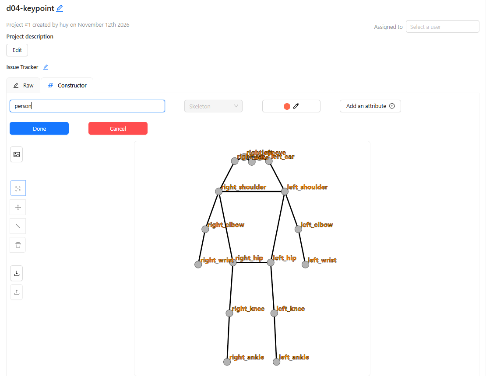
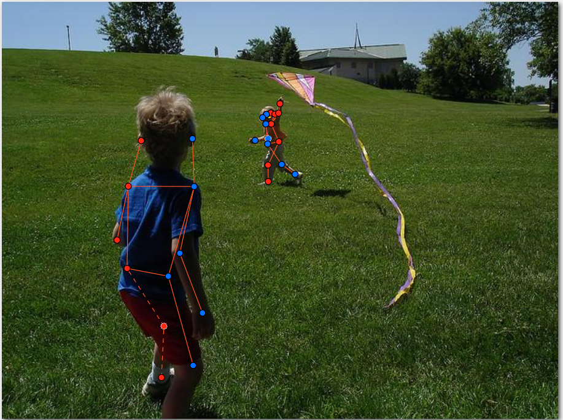
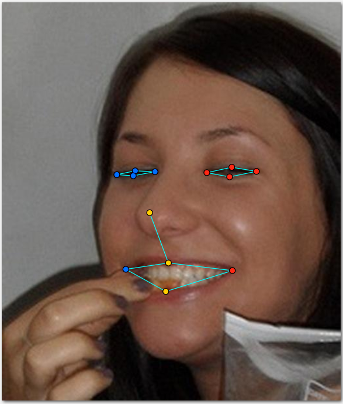
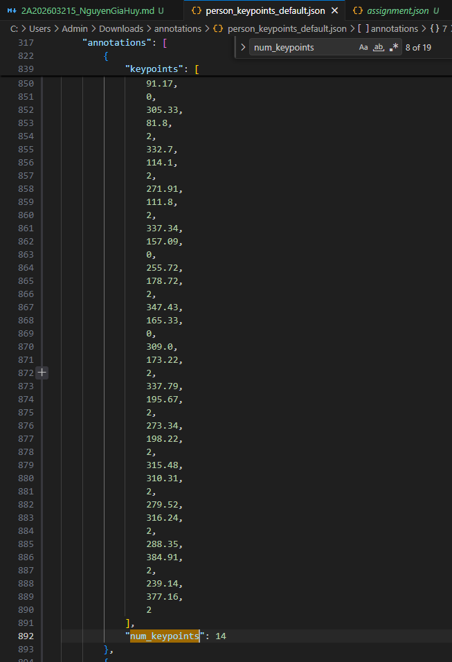

# Báo cáo cá nhân — Nguyễn Gia Huy-2A202603215

Dữ liệu: 12 ảnh người và 8 ảnh khuôn mặt từ COCO 2017; bonus gồm 3 ảnh người và 5 ảnh khuôn mặt. Nguồn theo `src/lab/NGUON_ANH.md`.

## 0. Thông tin học viên

- Họ tên: Nguyễn Gia Huy
- MSSV: 2A202603215
- Email: 26ai.huyng@vinuni.edu.vn
- Link repository: https://github.com/VamosHuiJia/K5-L2A-DAY04-NguyenGiaHuy-2A202603215-KeypointPose
- Phiên bản CVAT: v2.74.1
- Máy: Windows · RAM 16 GB · CVAT chế độ đầy đủ
- Bộ ảnh `src/exports/assignment.json`: có, đúng MSSV và gồm cả task bonus.
- Ngày làm: 12/11/2026, GMT+7
- Giờ bắt đầu: 16:00
- Giờ kết thúc: 23:20

## 1. Kiểm tra label (CP0)

| Label | Kiểu | Số điểm | Tên điểm đúng bảng của lab? | Đúng thứ tự? | Số cạnh |
|---|---|---:|---|---|---:|
| `person` | Skeleton | 17 | Có | Có | 19 |
| `face` | Skeleton | 13 | Có | Có | 13 |

Tên và thứ tự được đối chiếu trong JSON xuất với `src/keypoint_schema.json`. Mẫu `person` dựng theo người quay mặt về camera: có, `left_*` nằm bên phải khung mẫu.

Đổi cờ một điểm: rê chuột đúng điểm, nhấn `Q` để bật/tắt `occluded`, `O` để bật/tắt `outside`. Không dùng `hidden` thay cờ visibility.

## 2. Số lượng đã gán và thời gian (CP1, CP2)

| Nhóm ảnh | Số ảnh | Số skeleton đã gán | Số người dưới 60 px (không gán) | Số poster / gương / màn hình bỏ qua | Thời gian (phút) |
|---|---:|---:|---|---|---|
| `easy` | 5 | 5 | 0 | 0 | Không ghi riêng |
| `occluded` | 3 | 6 | 0 | 0 | Không ghi riêng |
| `back` | 2 | 4 | Khoảng 2 | 0 | Không ghi riêng |
| `small` | 1 | 1 | Khoảng 3 | 0 | Không ghi riêng |
| `crowd` | 1 | 3 | Khoảng 3 | 0 | Không ghi riêng |
| `faces` | 8 | 8 | — | 0 | Không ghi riêng |

Số người nhỏ là ước lượng khi rà ảnh gốc: `back` có các người nhỏ/bị che trong ảnh đường phố `000000023424.jpg`; `small` có khoảng ba bóng người nền ngoài người sát mép phải đã gán trong `000000323705.jpg`; `crowd` có khoảng ba người nền gần xe và quầy hàng trong `000000326480.jpg`. Riêng người bị che, chiều cao phần nhìn thấy không đủ xác nhận chiều cao toàn thân dưới 60 px. Cột poster/gương/màn hình ghi 0 theo xác nhận của học viên; không tự coi hình người ở góc ảnh là poster.

Tổng hiện có: **19 skeleton người và 8 skeleton mặt**. Đã có skeleton ở cả 12 ảnh người; ảnh `000000323705.jpg` còn cảnh báo phạm vi điểm cao khoảng 1 px. Chưa đối chiếu số người với ground truth.

- Số ảnh người đã xong ở mốc phút 105: không có số liệu ghi nhận.
- Thời gian CP1 / CP2 / CP3: không ghi riêng vì làm liên tục. Khoảng thời gian từ 16:00 đến 23:20 là 440 phút, gồm cả thao tác và các hoạt động xen kẽ, không phải 440 phút gán nhãn thuần.
- Trường hợp phân vân: `000000326480.jpg`, có ba người nói chuyện ở giữa và nhiều người phía sau; chưa chắc người nào thuộc phạm vi cần gán.
- Ảnh tốn thời gian nhất: chưa có thống kê thời gian riêng để kết luận.

## 3. Bảng ca khó (CP1, CP2)

Tôi gán liên tục một lượt, không gặp khó khăn lớn về thao tác nhưng còn phân vân ở các trường hợp dưới đây. Một số điểm được đặt theo ước lượng nên tôi chưa chắc về độ chính xác. Cột cờ ghi đúng bản xuất hiện tại, không khẳng định mọi lựa chọn đã chuẩn.

| Ảnh | Người / mặt | Điểm | Cờ đã chọn | Phân vân giữa | Lý do chọn |
|---|---|---|---|---|---|
| `face_185015.jpg` | Mặt nữ, mắt híp | Mí trên và mí dưới hai mắt | 2 | Vị trí hai mép mí khi khe mắt rất hẹp | Tôi phân vân cách đặt hai điểm mí khi mắt gần nhắm. Hai điểm cần bám mép mí thật và có thể rất sát nhau; mắt híp không tự động là bị che. |
| `face_380639.jpg` | Mặt nam nhìn xuống | Mí trên và mí dưới hai mắt | 2 | Mép mí thật và nếp gấp mí | Tôi đặt theo ước lượng và chưa chắc vị trí. Khi phóng to cần phân biệt mép mí với nếp gấp, không kéo hai điểm tách rộng hơn khe mắt thực tế. |
| `000000326480.jpg` | Người đứng sau nhóm ba người | Phạm vi tạo skeleton | — | Gán người nền / bỏ người quá nhỏ | Tôi phân vân có cần gán người phía sau. Bản đầu có một skeleton người nền; bản mới đã bỏ skeleton đó, còn ba người chính. Khi xác định phạm vi gán cần xét ngưỡng 60 px trên ảnh gốc; bị che không đồng nghĩa bỏ cả người. |
| `000000023424.jpg` | Các hình người ở góc xa bên phải | Phạm vi tạo skeleton | — | Người thật đủ ngưỡng / người quá nhỏ hoặc bị che | Tôi chưa chắc ngoài người áo trắng còn người nào cần gán. Cần phóng to để phân biệt người thật, vật thể và kích thước; không mặc định hình đứng gần biển hiệu là poster. Bản xuất hiện có hai skeleton người. |
| `face_300200.jpg` — bonus | Mặt có râu | `mouth_left`, `mouth_right` | 0 | Khóe miệng bị che nhưng ước lượng được / không xác định được | Ban đầu tôi ước lượng và dùng `v=1`. Bản mới đã chuyển hai khóe sang `v=0` do chưa xác định chắc đường môi sau râu. |
| `face_300200.jpg` — bonus | Mặt có râu | `lip_upper`, `lip_lower` | 0 | Thấy mép môi / đang đặt theo mép râu | Ban đầu để `v=2` theo ước lượng. Bản mới đã chuyển sang `v=0` vì chưa xác định chắc mép môi thật; không lấy đường viền râu thay đường môi. |

## 4. Bảng tự review (CP3)

Bảng ghi lại vấn đề ở bản trước và tình trạng sau chỉnh sửa, đối chiếu ảnh chụp và JSON mới. `ok` chỉ áp dụng cho phạm vi ghi trong dòng. Cảnh báo đã hết không đồng nghĩa nhãn đã trùng ground truth.

| Ảnh | Người / mặt | Điểm | Mã lỗi | Ghi chú | Đã sửa? |
|---|---|---|---|---|---|
| `000000461002.jpg` — back | Người phía xa | Gối và cổ chân | `lr_swap` | Đã chỉnh các cặp điểm; bản xuất mới không còn cảnh báo gối/cổ chân. | Có |
| `000000023424.jpg` — back | Người quay lưng gần camera | Tên hai vai | `ok` | Trong ảnh chụp, vai trái ở trái ảnh và vai phải ở phải ảnh, phù hợp hướng quay lưng. Các điểm khác không thuộc kết luận `ok` này. | — |
| `000000326480.jpg` — crowd | Người nền ở bản trước | Phạm vi tạo skeleton | `extra` | Đã bỏ skeleton người nền bị cảnh báo; số skeleton từ 4 còn 3, không còn cảnh báo này. | Có |
| `000000122199.jpg` | Người áo vàng | Hai gối | `lr_swap` | Đã chỉnh điểm; bản mới không còn cảnh báo cặp gối. | Có |
| `000000323705.jpg` | Người trong hậu cảnh | Skeleton người | `missing` | Đã thêm 1 skeleton; còn cảnh báo các điểm trải cao 1 px, chưa chốt điều kiện kích thước người. | Đã thêm; còn rà ngưỡng |
| `face_185015.jpg` | Mặt nữ mắt híp | Cờ các điểm mí mắt | `ok` | Đang để `v=2`; mắt híp nhưng mép mí thấy được. Kết luận này về cờ, không xác nhận độ lệch pixel. | — |
| `face_476363.jpg` | Mặt nam nghiêng | Hai nhóm mắt và hai khóe miệng | `lr_swap` | Đã đổi lại trái/phải; JSON mới khớp hướng người và không còn cảnh báo. | Có |
| `face_99874.jpg` | Mặt đeo kính râm | Tám điểm mắt và hai khóe miệng | `vis_flag` | Đã đặt 8 điểm mắt `v=1` và sửa trái/phải hai khóe miệng; bản mới không còn cảnh báo. | Có |

Tổng hợp số dòng theo mã lỗi/phạm vi đã rà:

| `lr_swap` | `vis_flag` | `position` | `missing` | `extra` | `ok` |
|---:|---:|---:|---:|---:|---:|
| 3 | 1 | 0 | 1 | 1 | 2 |

Điểm còn phân vân giữa `v=1` và `v=0`, hai lựa chọn và lý do:

Các điểm miệng trong `face_300200.jpg` bị râu che: phân vân giữa `v=1` (ước lượng chắc) và `v=0` (không xác định chắc). Bản mới chọn `v=0` cho cả bốn điểm miệng, không giữ tọa độ ước lượng như điểm nhìn thấy.

## 5. Kiểm file xuất và kết quả tự kiểm (CP4)

Đã xuất **COCO Keypoints 1.0**, không kèm ảnh. Kiểm các annotation trong JSON:

| File | Người / mặt kiểm (ảnh, thứ tự) | Số phần tử `keypoints` | Điểm `outside` ra `v=0`, `occluded` ra `v=1`? | `num_keypoints` khớp? |
|---|---|---:|---|---|
| `NguyenGiaHuy_persons.zip` | `000000023424.jpg`, annotation ID 1 | 51 | Có, có cả điểm `v=0` và `v=1` | Có: 12 điểm `v>0` |
| `NguyenGiaHuy_persons.zip` | `000000326480.jpg`, annotation ID 8; ảnh JSON mục 6.4 | 51 | Có `v=0`; mẫu này không có `v=1` | Có: 14 điểm `v>0` |
| `NguyenGiaHuy_faces.zip` | `face_185015.jpg`, annotation ID 1 | 39 | Mẫu này chỉ có `v=2`, không kiểm được hai cờ còn lại | Có: 13 điểm `v>0` |

CVAT xuất `occluded → v=1`, `outside → v=0`. Có 73 điểm `v=0` trong hai ZIP chính vẫn mang tọa độ cũ; đây không phải lỗi và không sửa JSON bằng tay.

Hai job chính đã chuyển sang **completed: Có**, theo xác nhận của học viên. Hai job bonus cũng đã Finish the job.

Kết quả tự kiểm trên các ZIP hiện có:

```text
----- TÓM TẮT (dán vào báo cáo mục 5) -----
- File person: NguyenGiaHuy_persons.zip
  Số ảnh: 12 · số skeleton `person`: 19 · mỗi annotation 51 số
  Skeleton theo ảnh: 000000023424=2, 000000122199=2, 000000137767=1, 000000240340=1, 000000323705=1, 000000326480=3, 000000360811=2, 000000393909=2, 000000399983=1, 000000429594=1, 000000451084=1, 000000461002=2
  Cờ v: v=2 223 (69%) · v=1 27 (8%) · v=0 73 (23%)
  num_keypoints trung bình: 13.2
- File face: NguyenGiaHuy_faces.zip
  Số ảnh: 8 · số skeleton `face`: 8 · mỗi annotation 39 số
  Skeleton theo ảnh: face_185015=1, face_300399=1, face_333134=1, face_380639=1, face_476363=1, face_81239=1, face_92028=1, face_99874=1
  Cờ v: v=2 96 (92%) · v=1 8 (8%) · v=0 0 (0%)
  num_keypoints trung bình: 13.0
- Ghi chú: 73 điểm v = 0 vẫn mang tọa độ cũ (CVAT 2.x xuất như vậy; chuẩn COCO ghi 0, 0). Không phải lỗi: điểm v = 0 bị bỏ qua khi huấn luyện và khi chấm.
- Số [LỖI]: 0 · số [CẢNH BÁO]: 1
Kết quả: ĐẠT (đọc lại từng cảnh báo ở trên)
```

Cảnh báo còn lại:

| Ảnh | Cảnh báo | Trạng thái |
|---|---|---|
| `000000323705.jpg` #1 | Chỉ hai điểm vai có nhãn, trải cao khoảng 1 px; script cảnh báo dưới 60 px | Bản mới chỉ giữ hai vai nhìn thấy; 15 điểm còn lại là `outside`. Độ trải điểm không phải chiều cao toàn thân. Giữ cảnh báo để coach đối chiếu phạm vi người đủ ngưỡng; không giãn điểm để hết cảnh báo. |

Hai ZIP mặt và các cảnh báo gối/cổ chân trước đó không còn cảnh báo. Tám điểm mắt kính râm đã có `v=1`; hai khóe miệng của `face_99874.jpg` đã đổi đúng phía. Script không có ground truth nên “ĐẠT” không xác nhận mọi vị trí đều đúng.

## 6. Ảnh chụp màn hình

### 6.1. Label person trong constructor



Nguồn: ảnh chụp giao diện CVAT của học viên. Coach đã xác nhận ảnh này dùng được.

### 6.2. Người quay lưng đã gán, có cờ



Nguồn: COCO 2017, `000000461002.jpg`; ảnh chụp nhãn trên CVAT.

### 6.3. Khuôn mặt 13 điểm, phóng to vùng mắt



Nguồn: COCO 2017, `face_185015.jpg`; ảnh chụp nhãn trên CVAT.

### 6.4. JSON xuất của một người



Nguồn: JSON xuất từ `NguyenGiaHuy_persons.zip`, annotation ID 8; thấy mảng `keypoints` và `num_keypoints: 14`.

## 7. Tự đánh giá

1. Lỗi mắc nhiều nhất và cách tránh ở dự án thật:

   Tôi chưa thống kê để kết luận lỗi nào mắc nhiều nhất. Tôi làm một mạch nên một số điểm còn đặt theo ước lượng, đặc biệt ở mắt híp và miệng bị râu che. Tôi cần kiểm lại độ chính xác, phân biệt điểm nhìn thấy với điểm chỉ suy ra vị trí.

2. Một quy tắc đề xuất thêm vào guideline:

   Bổ sung ví dụ phóng to cho mắt gần nhắm, môi bị râu che và người nhỏ phía sau vật cản; mỗi ví dụ nêu căn cứ chọn cờ và điều kiện tạo skeleton. Cần phân biệt ước lượng có căn cứ với đặt điểm chỉ để đủ số lượng.

3. Một lỗi đã sửa và ảnh hưởng đến heatmap, trọng số loss hoặc đổi trái/phải khi lật ảnh:

   Khi gán người quay lưng, tôi đã kéo lại các điểm trái/phải theo hướng của người thay vì giữ nguyên mẫu quay mặt. Nếu giữ sai tên, heatmap của khớp trái sẽ nhận vị trí khớp phải; bước lật ảnh đổi cặp trái/phải cũng tạo dữ liệu không nhất quán. Bản xuất mới đã chỉnh các cặp gối và nhóm mắt/miệng được ghi trong bảng review; các cảnh báo tương ứng đã hết, chưa có đối chiếu độ lệch với ground truth.

## 8. Khó khăn và lỗi kỹ thuật

Tôi không gặp khó khăn lớn về thao tác; chủ yếu phân vân ở cách đặt mí mắt híp, người nhỏ/bị che trong cảnh đông và đường môi bị râu che. Một số điểm được đặt theo ước lượng nên chưa chắc hoàn toàn.

Lỗi kỹ thuật: không có sự cố kỹ thuật được ghi nhận trong nội dung trao đổi; các lần xuất và kiểm file đều chạy thành công.

## Bonus (nếu làm)

### B1 — 3 ảnh người khó thêm

| Ảnh | Số skeleton | Số người dưới 60 px | Ca khó nhất |
|---|---:|---|---|
| `000000125998.jpg` | 3 | 0 | Ba người bị cắt khỏi khung ở phần trên, laptop che thân; phải phân biệt từng cặp chân và dùng `outside` cho khớp không xác định được. |
| `000000196853.jpg` | 2 | 0 | Tay gập sát thân và phần chân bị cắt. Bản nộp hiện tại gán hai người phía trước; người áo đen ở nền chưa được gán. |
| `000000357549.jpg` | 3 | 0 | Người sát mép trái bị cắt đầu; xe đạp và người phía trước che các khớp. Đã rà điểm mắt sát mép, bản mới không còn cảnh báo. |

Không thấy người dưới 60 px có thể nhận diện rõ trong ba ảnh bonus. Người chỉ lộ chân hoặc bị cắt khung không được tính là người nhỏ chỉ vì phần nhìn thấy ít. Số skeleton ghi theo ZIP hiện có; học viên chọn giữ bản nhãn này. Kết quả script không kiểm chứng được mọi người trong ảnh đã được gán đủ.

Kết quả tự kiểm:

```text
----- TÓM TẮT (dán vào báo cáo mục 5) -----
- File person: NguyenGiaHuy_bonus_persons.zip
  Số ảnh: 3 · số skeleton `person`: 8 · mỗi annotation 51 số
  Skeleton theo ảnh: 000000125998=3, 000000196853=2, 000000357549=3
  Cờ v: v=2 66 (49%) · v=1 5 (4%) · v=0 65 (48%)
  num_keypoints trung bình: 8.9
- Ghi chú: 65 điểm v = 0 vẫn mang tọa độ cũ (CVAT 2.x xuất như vậy; chuẩn COCO ghi 0, 0). Không phải lỗi: điểm v = 0 bị bỏ qua khi huấn luyện và khi chấm.
- Số [LỖI]: 0 · số [CẢNH BÁO]: 0
Kết quả: ĐẠT
```

Đã rà điểm mắt sát mép trong `000000357549.jpg`; bản ZIP mới kiểm tra không có lỗi hoặc cảnh báo. Chưa đối chiếu ground truth.

### B2 — 5 ảnh khuôn mặt đen trắng / hồng ngoại

Đã gán 5 skeleton, mỗi ảnh một mặt: `face_280788.jpg`, `face_300200.jpg`, `face_379585.jpg`, `face_507166.jpg`, `face_68290.jpg`.

Kết quả tự kiểm:

```text
----- TÓM TẮT (dán vào báo cáo mục 5) -----
- File face: NguyenGiaHuy_bonus_faces.zip
  Số ảnh: 5 · số skeleton `face`: 5 · mỗi annotation 39 số
  Skeleton theo ảnh: face_280788=1, face_300200=1, face_379585=1, face_507166=1, face_68290=1
  Cờ v: v=2 59 (91%) · v=1 2 (3%) · v=0 4 (6%)
  num_keypoints trung bình: 12.2
- Ghi chú: 4 điểm v = 0 vẫn mang tọa độ cũ (CVAT 2.x xuất như vậy; chuẩn COCO ghi 0, 0). Không phải lỗi: điểm v = 0 bị bỏ qua khi huấn luyện và khi chấm.
- Số [LỖI]: 0 · số [CẢNH BÁO]: 0
Kết quả: ĐẠT
```

Nhận xét thực tế về điểm khó khi gán ảnh không màu: ở `face_300200.jpg`, râu che khiến tôi khó phân biệt đường viền môi. Ban đầu đã đặt theo ước lượng; sau khi rà, bản mới chọn `v=0` cho cả bốn điểm miệng vì chưa xác định chắc vị trí. Không lấy mép ria/râu làm đường môi.

Với kính râm trên ảnh hồng ngoại, xét theo chính ảnh: điểm thấy rõ là `v=2`; bị che nhưng ước lượng chắc là `v=1`; không xác định được là `v=0`. Không mặc định cờ chỉ dựa vào tên loại kính.

### B3 — Model so với nhãn của tôi (không tính điểm)

Không có kết quả B3 để báo cáo. Phần bonus nộp trong bài này gồm B1 và B2.

## 9. Tài liệu tham khảo và công cụ AI đã dùng

- [Quy ước nhãn](../../docs/GUIDELINE.md), [hướng dẫn CVAT](../../docs/CVAT_CHEATSHEET.md), [COCO Keypoints và OKS](../../docs/COCO_KEYPOINTS.md).
- [Nguồn ảnh và giấy phép](../../src/lab/NGUON_ANH.md), [pool dữ liệu](../../src/lab/pool.json).
- Codex/ChatGPT: giải thích quy tắc, hướng dẫn CVAT, đối chiếu ảnh chụp/JSON, giải thích cảnh báo và hỗ trợ biên tập báo cáo từ ghi chú của học viên. Bảng rà soát có ghi nhận hỗ trợ kiểm tra này; không phải mọi cảnh báo đã được học viên xác nhận hay sửa trên job. Có sử dụng hình minh họa tham khảo trong trao đổi; các ảnh minh chứng trong báo cáo đều là ảnh chụp của học viên.
